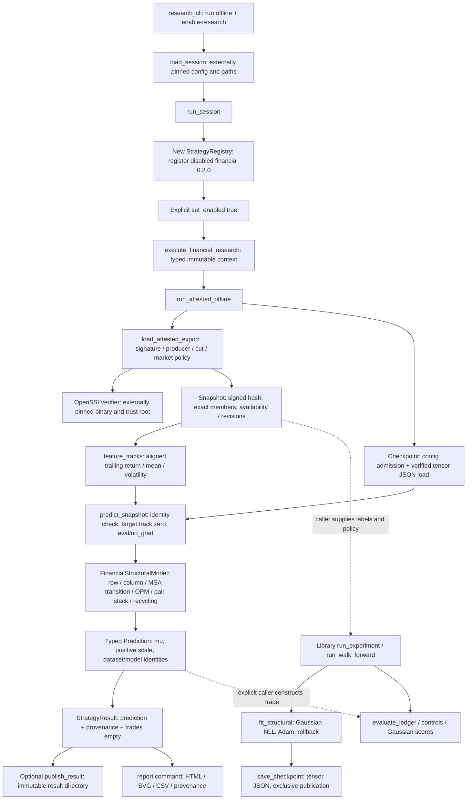
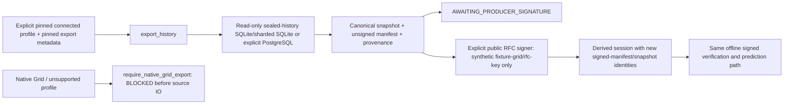
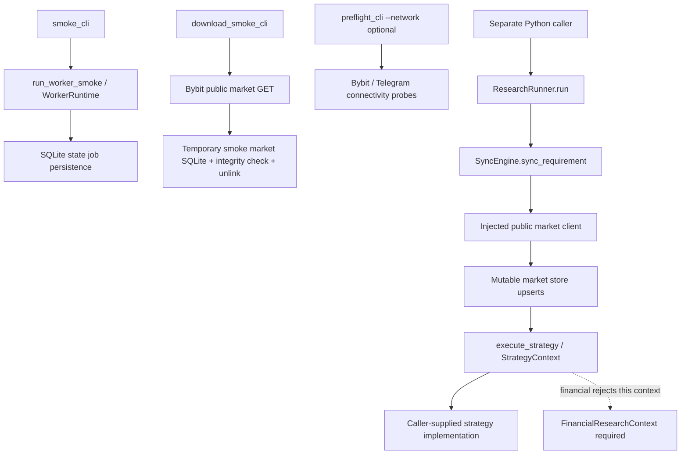

# Actual runtime architecture and ownership — source inspection, 2026-10-26

Inspected repository: `C:/Users/LS-5/Documents/Codex/2026-10-24/files-pasted-by-the-user-codex/work/strattester`, HEAD `af6b5f345eb1df99ef55de11c2902f0b55bbb287`. This document is outside that repository. Inspection was read-only: no model execution, package preparation, OpenSSL invocation, native executable, database connection, service or production action was performed for this audit. Tests below are source-located coverage, not fresh test results.

The checkout was dirty: workflows, pyproject, gate/acceptance files were modified, and owner-authorization/test-package modules and their tests were untracked. Therefore HEAD alone does not identify all inspected bytes. SHA256 at inspection:

| File | SHA256 |
|---|---|
| `strattester/research_cli.py` | `5ffa5265b733d8ba663da5b2ebe603c6ce1d2972cc32570615d704184b6688c2` |
| `strattester/research/financial_session.py` | `41593513ec99307a8285c446407832450fa71c8b1b440a303a8005ad7577aa31` |
| untracked `strattester/research/financial_owner_authorization.py` | `1c259bad5197a901337d4d2f833930086915213375734320af7fb6aaa87b16c7` |
| untracked `strattester/research/financial_test_package.py` | `878e5216da28ff2d6fc8c4f50ff3b6fa0093019f3d504fdb37f4c451fc0cf0d2` |

## Reachable research path

The research entry point is explicitly `python -m strattester.research_cli`. It is not automatically registered by ordinary smoke/download/preflight commands. There is no `strattester/__main__.py` entry point in this checkout. Registration is real but deliberately local to the opted-in session; the generic mutable-store executor is not the financial executor.

Solid arrows describe an implemented call path. Dashed arrows require a separate caller and supplied labels/trade choices; they are not automatic CLI actions. `FinancialStructuralResearch.run_context` returns `trades=[]`. Neither `run`, `verify`, `diagnose` nor `report` automatically runs the experiment or a trading backtest. The signed-data end-to-end test constructs one `Trade` itself and calls `evaluate_ledger`; that is a bounded library composition, not a deployed backtest service.

`verify` and `diagnose` call `verify_session` → `run_attested_offline`, so they verify the checkpoint and actually execute CPU model inference; they are not hash-only inspections. `verify` returns provenance rather than the prediction. `report` calls `run_session` again, requires `--enable-research` through that function, and then renders the newly computed prediction; it does not load a previous result file. `run --output` optionally publishes JSON. `report --output` publishes four report files. Normal research results remain `NO-GO` for trading and `NOT_AUTHORIZED` for physical G1.

## Data/connected path and ownership

`connected` means an explicitly selected historical export capability. It does not mean exchange streaming or order execution. An unsigned ordinary connected export returns `AWAITING_PRODUCER_SIGNATURE` and does not infer a prediction. Automatic signing exists only for the deliberately public synthetic fixture producer/key. A production producer signing service, deployment key provisioning, and conversion of that unsigned return into an updated externally pinned real-data session are outside this implementation.

The producer owns first-availability/revision retention, source completeness, source/partition routing, coherent epoch and signed immutable cut truth. The caller/operator owns independent expected digests, allowed producer/policy, trust root, verifier binary/libraries, scratch ACLs and selected database endpoints. Consumer verification authenticates these assertions and checks consistency; it cannot reconstruct historical facts missing from an overwritten database. Matching timestamps across sources does not establish coherence. Each source is read in its own transaction and checked against a supplied logical content seal; this is not one distributed database transaction or a physical live-file backup.

## Module contracts and ownership

Paths below are relative to the inspected repository. `ValueError` denotes contract failure unless a more specific error is listed. No row's software limit is an OS-level CPU/RSS/filesystem/network confinement guarantee.

| Module / owner | Actual caller; input → output | Errors and resource admission | External actions and recovery | Source-located tests |
|---|---|---|---|---|
| `research_cli.py` — command boundary | Explicit module invocation; arguments/pins → redacted JSON and exit status | Missing pins/mode/schema fail; ordinary exceptions become `RESEARCH_ERROR` with type only and exit2; Ctrl-C gives `RESEARCH_CANCELLED`,130. Argparse errors occur outside main's try. `BLOCKED` returns2; `AWAITING_PRODUCER_SIGNATURE` is not mapped to2. | Dispatches underlying file/process/DB operations only via chosen command. Does not invoke native research execution, even when `--launch` is present. | `test_financial_session`: reachable CLI/redaction/no implicit enable, unsupported verification clock, relative-profile confinement. |
| `financial_session.py` — orchestration | CLI or library; pinned config/trust digest/verifier → `ResearchSession`, verified provenance or result | Config64KiB, exact schema; plain relative bundle filenames; no traversal/reserved names/reparse ancestry. Session work budget16MiB–1GiB. Explicit enable and offline/connected separation. | Creates local registry; optional export/result publication. Cooperative cancellation before/after stages. No automatic service/SyncEngine invocation. | `test_financial_session`: signed registry prediction/report, hashes/path, offline capability denial/cancel, connected synthetic route, native-block-before-DB, no socket route. |
| `strategies/registry.py`, `builtin/financial_structural.py` — strategy ownership | Session; explicit `research_only=True`, typed context → disabled definition, then enabled `StrategyResult` | New registry starts empty. Exact implementation/id/version required; disabled rejects. `FinancialResearchContext` exact type and `checkpoint=None` required. | Registration/enabling mutates only local registry; backend calls attested inference. `trades=[]`. Generic store contexts rejected. | `test_financial_research_registry`: explicit disabled registration, required enable, generic-store rejection. |
| `financial_attested_inference.py` — inference job admission | Financial backend/verify/stream; request+policy+verifier → `OfflineInferenceResult` | Request horizon/time identity, availability after signature verification and before origin+horizon; aggregate software charge `config.max_work_bytes + 16*serialized_inputs` ≤ requested16MiB–1GiB before model allocation. | File reads and verifier subprocess downstream; cancellation before reads, around loading/inference. No DB/client/order object accepted. | `test_financial_attested_inference`: signed training/reload/prediction→explicit ledger; market/timeframe matrix, aggregate-before-allocation, cancellation-before-IO, no backdated availability, target permutation. |
| `financial_signed_export.py` — authenticated consumer | Attested job; manifest/snapshot/trust pins and policy → validated `Snapshot`+provenance | Manifest256KiB, snapshot≤8MiB/100k rows; exact schemas, scope/members/epoch/cut, schema hash, row/count/provenance, issue freshness≤900s, active unrevoked key at issue and verification. Rejects callback verifier. | Reads files and invokes pinned verifier. Does not query DB or sign production exports. Cancellation during verification. | `test_financial_signed_export`, `test_financial_signatures`: tamper/substitution/replay-scope/key validity/schema/partition/receipt rejection. |
| `financial_signatures.py` — external crypto boundary | Signed-data and owner-plan consumers; public key/message/signature → boolean verified; trust JSON → typed trust store | Trust≤64KiB/64keys; key32bytes, signature64bytes, message≤1MiB; pinned executable≤64MiB; absolute executable, 5s subprocess timeout. | Writes transient DER/message/signature/config in operator scratch; runs OpenSSL3 `pkeyutl` with literal argv, no shell and restricted environment. TemporaryDirectory cleanup on normal return/failure. Executable hash does not qualify dynamic libraries/ACLs. | `test_financial_signatures`: actual RFC8032 verifier and negative cases; package/owner tests reuse it. |
| `financial_snapshot.py`, `financial_contract.py` — artifact/timing boundary | Consumer/checkpoint/export/session; bounded bytes and typed fields → canonical bytes/validated bars/snapshot/prediction | SHA256 pin, ordinary single-link file, ancestor symlink/reparse checks, bounded read+identity recheck; JSON depth≤64, duplicate/nonfinite rejection; snapshot semantics reject invalid timing/quality/provenance. | Filesystem reads; separate normalized SQLite helper is read-only with query_only, trusted_schema off and rollback. No production schema invention. Hostile namespace races still require native handle confinement. | Snapshot/security/junction tests and signed export tests. |
| `financial_pipeline.py` — financial feature/model boundary | Attested inference and experiment; validated snapshot/config → aligned float32 `[1,S,N,3]` tracks; checkpoint model+target → typed Prediction | Exact same-time tracks, supported3channels, track/token/byte caps; trained/aligned horizon; checkpoint digest+parameter fingerprint must match; target must exist. | No external IO beyond in-memory canonical hashing. Target instrument reordered to track0; eval/no_grad, restores prior training mode in finally. | `test_financial_contract`, `test_financial_offline_e2e`, `test_financial_offline_bridge`; explicit target/time tests in attested inference; `test_financial_checkpoint` identity/reload. |
| `financial_structural_model.py` and `alphafold_*` operators — model ownership | Pipeline/training; features+binary mask → `[batch,2]` mean/scale | CPU float32/float64 only with matching model; config/parameter caps before construction; hard element/workspace admission before projection; finite masks/features/output; empty target window rejects. Default hidden8/heads2/intermediate4/depth1/recycles1; version2 equations. | Pure tensor compute; no network/DB/files. Uses available historical window, not per-position causal streaming. Budget is per forward and conservative estimate, not whole-process enforcement. | `test_financial_structural_model`, `test_structural_upstream_differential`, row/column/OPM/pair/triangle tests. NumPy equations/finite differences are bounded CPU checks, not full upstream equivalence. |
| `financial_checkpoint.py` — model identity/persistence | Prepare, experiments, attested inference; finite model+dataset digest → tensor JSON+digest; externally pinned JSON → verified model+metadata |≤8MiB; exact tensor shapes/names/finite float32 values; required exact integer `model_equations_version=2`; missing/legacy equations rejected before model allocation. No pickle/eval/torch.load. | Save checks parent paths, writes/fsyncs temp, hardlinks exclusive final, unlinks temp, verifies final; never overwrites existing checkpoint. On postpublication failure preserves unregistered final for operator recovery. Load only reads. No optimizer/RNG/step-resume state. | `test_financial_checkpoint`, legacy version differential tests, checkpoint junction tests. |
| `financial_training.py` — bounded optimization | Prepare/experiment/library; model+feature bank+labels/mask → loss tuple and updated model |≤1000steps,≤1024samples, bounded learning rate and bank charge before state copy; model enforces batches/workspaces. Rejects bad labels/nonfinite loss/gradient/weights. | In-memory Adam/NLL, clip1; deterministic-algorithm state and model mode restored. On any BaseException reloads original model state. Cooperative cancel between steps; no implicit checkpoint or external IO. | `test_financial_training`: real updates/seed repeat, cancellation rollback, labels and bank admission. |
| `financial_experiment.py` — research evaluation owner | Separate library caller, not prediction CLI; typed labelled `Example`s and split/cost settings → synthetic report+checkpoint(s) |≤1024examples,≤32folds, preparation charge before tensors; aligned horizons/windows; purged half-open splits, embargo, label overlap checks, optional symbol holdout, frozen validation threshold before test. | Materializes bounded feature banks, trains fresh model, evaluates, writes checkpoint only after evaluation succeeds. Walk-forward validates windows before outputs; completed earlier folds remain if later work fails. No atomic all-fold transaction or resumable optimizer. | `test_financial_experiment`: real updates, future dependency/horizon/holdout, eval-failure-before-save, walk-forward purity, preallocation/cancel/generator caps. |
| `financial_evaluation.py` and `research/alphafold_training` — metrics/backtest helpers | Experiment or explicit caller builds `Trade`s; returns+costs → simple-return ledger, controls, NLL/MAE/95%coverage and exploratory CI | Nonoverlapping per-series intervals; position−1/0/+1; finite costs; current ledger funding is flat nonnegative charge. No exchange fill model. | In-memory computation; caller supplies realised labels/trade decisions. Entry/exit each horizon; no leveraged portfolio/margin liquidation. Controls fit supplied train data; delayed control is strictly prior same series. | Financial evaluation/experiment and training baseline/evaluation/gates/independent-oracle tests. Standalone signed-funding reference does not wire historical funding into this ledger. |
| `financial_offline_jobs.py` — streaming/publication owner | Optional library batch wrapper/session publish; lazy `OfflineJob`s → yielded results/immutable directories | Maxrequests default32/ceiling256; charge17MiB per input before inference; bounded result tree8192nodes/depth32 and≤1MiB;≤64existing output entries. | `publish_result` recomputes expected bytes, verifies replay, recovers matching complete stage by directory rename, preserves partial/conflicting stages in receipt. Caller-owned output scratch required; owner cleanup needed at entry cap. No power-loss durability or OS isolation claim. | `test_financial_offline_jobs`: laziness/cumulative admission, cancellation, tamper, abrupt-exit restart, partial preservation, identical/conflicting concurrent publication. |
| `financial_report_export.py` — presentation owner | CLI report/library; result prediction+provenance → HTML/SVG/CSV/JSON directory | Finite mu/positive scale, existing output denied, checked parent. Escapes HTML and CSV formula prefixes; CSP restricts external content. | Writes temp directory then rename; no network or JavaScript. Existing report has no replay/recovery API; caller chooses new output. SVG curve is a fixed bell shape annotated with mu/scale, not a calibrated empirical distribution chart. | `test_financial_session`: immutable output, escaping, expected files/NO-GO labelling. |
| `financial_grid_exporter.py` — qualified history export owner | Explicit connected session/library; sealed profile+metadata → canonical snapshot, unsigned manifest, provenance | Profile `SEALED_VERSIONED_HISTORY_V1`;≤64sources/256partitions/100krows/8MiB; exact physical normalized schema, raw octet/cell/query limits, seals, contiguous revisions+first availability, disjoint routing. PostgreSQL explicit credential-free endpoint policy and≤3s connect/5s statement timeout. | SQLite mode=ro/query_only/trusted_schema off with progress handler and transaction rollback; PostgreSQL repeatable-read/read-only and server cursor. Publishes directory; verifies exact existing replay; preserves failed stages/cleanup inventory. No production writes/migrations. | `test_financial_grid_exporter`: native-before-IO block, seals/WAL consistency, shard routing, raw octet/cell caps, partial/retry/replay, optional disposable PostgreSQL test, explicit DSN policy. Optional test existence is not evidence it ran on this host. |
| `grid_producer_readiness.py` — native source truth gate | Connected unsupported/native profile; request → `NativeGridExportBlocked` | Pinned source audit lists missing first availability/revisions/coherence/routing/schema/completeness/producer export. No caller assertion bypass. | Fails before physical source IO. Source hash audit is not a production schema/version or producer-issued receipt. | Grid readiness/native-before-path-access tests. |
| `financial_offline_bridge.py` — older explicit library boundary | Separate Python caller; snapshot/checkpoint pins+trusted producer/coherence strings → typed Prediction | Validates request, snapshot, checkpoint, trained horizon and prediction availability. Does not authenticate a producer signature or provide the signed-job aggregate admission contract. | Reads explicitly pinned local artifacts and runs CPU inference; no registry, SyncEngine or live store. It is not the research CLI's signed entry route. | `test_financial_offline_bridge`, `test_financial_offline_e2e`. |
| untracked `financial_test_package.py` — public software-fixture packaging | CLI prepare/library; pinned verifier+scratch, seed, optional independently pinned binary → package directory+ZIP+pins | Refuses existing output/ZIP; optional binary≤8MiB, verifier≤64MiB; seed typed. Builds 18 synthetic bars:3symbols×2timeframes×3tokens;2 optimizer steps. No general hard package-size limit over collected runtime/dependency metadata. | Reads Git HEAD/tree/status, source files and installed distribution metadata; writes temp stage/files/fsync, public fixture key/signature, actual CPU training/checkpoint, runtime/native source copies, manifests/lock, rename and exclusive ZIP. Public RFC key is intentionally not secret/production trust. No install. Failures may leave stages or completed directory/partial ZIP; no general automatic destructive cleanup/replay recovery. | Untracked `test_financial_test_package`: prepares signed offline session, verifies pins/template and existing-output/bad-binary refusal. Two tests do not establish bit-identical cross-environment ZIPs or native enforcement. |
| untracked `financial_owner_authorization.py` — owner intent verification | CLI test-disposable/library; external plan/signature/trust pins+independent exact SHA/tree/binary/package/node/time → verification receipt only | Plan≤64KiB; exact purpose/schema, identity/digests,≤600s validity, only `synthetic_cpu_inference`; maxima10%CPU/2GiB/60s/64MiBoutput/1process; active key at issue+now; pinned OpenSSL signature. | Reads external authorization; verifier subprocess/temp files. Never creates/collects owner private key, consumes nonce, starts native process or enforces limits. Signature valid ≠ G1 authorized. Plan outside ZIP avoids package-hash cycle. | Untracked `test_financial_owner_authorization`: valid necessary-not-sufficient signature, signed mismatched identity/time/purpose/operation, substituted signature. |

## Legacy runtime is a different capability graph

`ResearchRunner` first synchronizes a definition's requirements, requires READY for required history, then calls generic `execute_strategy`. `SyncEngine` can fetch candles, mark/index/premium, OI, funding and long/short data and upsert the mutable store. It refuses historical-public-trade substitution using recent REST trades. Exceptions are classified UNAVAILABLE/DEGRADED/RETRYABLE with original text in the returned message; this is not the research CLI's redacted exception contract. No transaction rollback across completed downloads is implied.

Generic `execute_strategy` checks requirements but does not enforce the definition's `enabled` flag. It instantiates arbitrary caller-supplied implementations and dispatches `run_context` or legacy `run(candles)`. It must not be presented as globally offline or order-proof: injected Python implementations/clients have their own capabilities. The financial implementation rejects its mutable `StrategyContext`; opting into the financial route requires the dedicated registry executor. Smoke persists its state database; download-smoke fetches network data, creates a dedicated market SQLite file and removes that file/WAL/SHM afterward. Preflight network checks are opt-in. These paths are not invoked by financial offline sessions.

No inspected financial inference route imports an exchange order client. That scoped observation does not prove machine-wide egress denial, service isolation or the safety of arbitrary legacy strategy injection. Native component probes documented in `native/windows/README.md` can exercise owned processes/tokens/jobs/WFP/socket components, but the broker has no research-workload creation path. `--launch` remains blocked. This audit did not run those components.

## Final acceptance boundaries / missing paths

1. **Physical research launch remains deliberately absent.** `test-disposable` verifies the external signed owner plan then always returns `BLOCKED`, `launched=False`, `physical_g1=NOT_AUTHORIZED`, even with `--launch`. Native all-controls receipts, one-shot atomic nonce consumption, confined workload creation and all requested enforced controls are required before a future launcher can exist. A signed limits dictionary is not enforcement. No nonce replay prevention is claimed for verification alone.
2. **Native Grid producer output is blocked.** The sealed normalized-history exporter is implemented for an explicitly qualified profile. It does not make current latest-state Grid storage historically complete. Producer authority, deployed schema, retained first knowledge/revisions and coherent cuts remain external evidence.
3. **Prediction→trade/portfolio execution is not an automatic path.** Runtime strategy returns no trades. The library ledger and neural walk-forward experiment exist, but the CLI does not feed predictions into an account simulator, exchange orders, historical signed event funding or live strategy executor. No all-asset exchange realism is proven by generic instrument/timeframe fields or synthetic identity matrices.
4. **Training/fixture preparation is not market acceptance.** Public package uses synthetic labels and a publicly known producer key. Real OOS, calibration fit/diagnostics/thresholds, common cost-aware controls, portfolio fills/latency/funding/margin and profitability acceptance remain separate. Checkpoint reload reproduces inference identity; optimizer resume is unsupported.
5. **CPU structural adaptation is not original AlphaFold.** Equation version2 corrects incoming projection orientation. Independent row/column/triangle NumPy outputs/gradients and recurrence boundaries are bounded tests. OPM count/projection normalization, all-track differentiable recycling, financial inputs/head, initializations and masking differ upstream. No JAX/Haiku/pretrained-weight/whole-network equivalence or GPU PASS follows.
6. **Software admission is not native confinement.** Byte/row/tensor budgets and cancellation reduce accepted work; they do not enforce process RSS, total concurrency, preemption of every blocking call, arbitrary filesystem access or no egress. Python path checks cannot exclude hostile namespace races. Operator-controlled verifier/library paths, scratch/output ACLs and independently enforced native controls remain necessary for physical acceptance.
7. **Package provenance needs the actual final snapshot.** `source_sha/tree_sha` refer to committed HEAD while copied runtime files may be dirty/untracked; `source_dirty` and per-file hashes reveal this difference. The dependency lock records installed names/versions/licenses, not wheel hashes, vendored wheels or automatic offline environment reproduction. Optional native bytes are hash-pinned, not qualified by packaging. Current untracked files must be committed and final ZIP/config/trust/binary pins recomputed before presenting an immutable release identity.

## Evidence ownership checklist for the final handoff

| Evidence / decision | Responsible boundary |
|---|---|
| Exact final commit/tree, dirty-state resolution, source/ZIP/native hashes, artifact index and CI receipts | Coordinator/release owner; source inspection here is not a release signature |
| Native producer truth, authorized real dataset, retained knowledge/revision history, coherence/partition/schema receipts and signing key provisioning | Data producer/operator |
| Independent expected config/trust/verifier hashes and scratch/output ACLs | Session operator/security owner |
| CPU equations/model compatibility, checkpoint identity, trained horizon and numerical limits | Model owner |
| Real OOS labels, split/multiplicity/calibration/cost/fill policy and acceptance | Research/methodology owner |
| Owner intent signature for exact package/node/operation and bounded validity | External owner, outside ZIP; cannot substitute for native controls |
| Independently verified native enforcement, one-shot nonce claim and physical execution authorization | Physical/security acceptance owner; currently BLOCKED |

The implemented research route can be described as an explicit signed-data CPU prediction/report system with bounded software admission and separate synthetic training/evaluation APIs. Its current ownership boundaries do not authorize production trading or physical G1.

### Post-audit explicit experiment entry point

PR34 d4938bd adds `research_cli experiment` →
`financial_experiment_session.run_experiment_file` → bounded externally pinned
synthetic-only JSON → typed snapshots/examples → `run_experiment` → fresh
training/checkpoint → hash-verified `load_checkpoint` → target-specific
`predict_snapshot` for each purged test example → `evaluate_ledger` and
`gaussian_scores` with exact replay comparison → atomic checkpoint/result
directory. Three-instrument/two-timeframe subprocess tests exercise 18 test
forecasts. This explicit path closes the CLI training/prediction/evaluation
reachability gap described above; signed producer inference remains a
separate entry point. Synthetic labels cannot promote real OOS readiness.
Output refuses overwrite and cancellation prevents publication. Filesystem
races and OS ceilings still require qualified native confinement.

Other research prototypes such as `financial_evoformer.build_financial_model` and `financial_structure_dataset.make_samples` have their own tests but are not called by the inspected CLI/session/financial-strategy/pipeline/structural-model path. Their presence must not be counted as an additional connected prediction stage.
