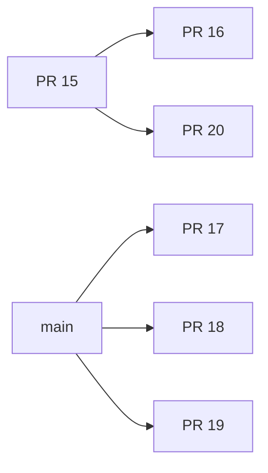

# AlphaFold financial integration: initial independent audit

Status: **NO-GO**. Stage A inventory/dependency analysis and Stage B CI evidence collection performed; full mechanism verification and Stages B-H implementation/acceptance remain incomplete. No source PR was merged, cherry-picked, edited, or commented on. No production database, model weights, or trading endpoint was opened.

## Pinned sources

All six source PR heads were queried through the GitHub connector and matched the supplied checkpoints. Descriptions are stale in places; code is authoritative.

| Source | Exact HEAD |
|---|---|
| strattester main / integration starting point | `37ff7e9d12a4d2dccd788fc493c28557dbe8bcea` |
| PR 15 | `02bb79796b9627345b8f7c98a50349d044e5b7be` |
| PR 16 | `5aadb120ac37f4832ea74c055051878c6a3171c6` |
| PR 17 | `d282a869f54a75e55bac5b519dd63ca845376a2a` |
| PR 18 | `9b7465c7336ffa9d14eaa01162043b5cab297c9b` |
| PR 19 | `0df7233c0f14f5a481889d914b5b96b70692bf12` |
| PR 20 | `bcf47a2cb8a6200790f77aadf52292311eec3c09` |
| bybit-cluster-grid main | `d537d525296ef34f727996e240ae6c60102c6082` |
| math main | `ccfe97dd88b1ebee9bd19795002a30d0bd1c1ca3` |
| google-deepmind/alphafold main | `c77e5d2a8961d1a353632c462914ff0a32a950f6` |

## Repository inventory

| Repository | Dependencies / interfaces | Tests / license |
|---|---|---|
| Strattester | Python >=3.11; requests, psutil, tzdata; optional psycopg and pytest. SQLiteMarketStore, ShardedMarketStore, Candle, schema v2. | Extensive tests under tests/; no tracked LICENSE at pinned main. |
| Grid | aiohttp, websockets, asyncpg, psutil, pydantic/settings, FastAPI, uvicorn, httpx, dotenv; optional numpy/scipy/sklearn/joblib/xgboost/lightgbm. PostgreSQL market_events, candles_1m, ohlcv_1m, market_features_1m and watermark tables. | Extensive tests/; no tracked LICENSE at pinned main. Dependencies have lower bounds, ML dependencies mostly ranges. |
| math | Pinned tree contains **only README.md**. Advertised browser prototype, Node tests and symbolic service are not present. No executable financial oracle or schema exists at this HEAD. | No test files, dependency manifests or LICENSE. README explicitly says no default license granted. |
| AlphaFold 2 | JAX 0.4.26, Haiku 0.0.12, numpy 1.24.3, tensorflow-cpu 2.16.1, OpenMM CUDA12, protein pipelines and atom/residue representations. Native modules.py has MSA attention, OPM, triangle operators, Evoformer and recycling. | Tracked *_test.py; Apache-2.0 LICENSE. No upstream tests executed here. Biological weights not downloaded. |

Do not combine the upstream biological environment with Grid's numpy>=2 runtime. Prefer isolated reference environments. Any reused upstream code needs Apache notice/source attribution; absent licenses in the user's repos remain an explicit redistribution question, not a claim that those repos are Apache licensed.

## PR ancestry, duplication and compatibility

`git merge-base --is-ancestor` for all 30 ordered pairs gives only:



PR 16 includes all 21 changed files from PR 15 byte-for-byte. Do not import PR 15 twice. PRs 17,18,19 have no overlapping changed paths with each other or the other three PRs.

PRs 16 and 20 share 12 identical changed paths and nine divergent paths:

- strattester/research/financial_evoformer.py
- strattester/research/financial_structure_dataset.py
- strattester/research/protein_geometry.py
- strattester/research/protein_geometry_offline.py
- strattester/research/protein_geometry_snapshot.py
- tests/research/test_financial_evoformer.py
- tests/research/test_financial_structure_dataset.py
- tests/research/test_protein_geometry.py
- tests/strategies/test_protein_geometry.py

At these HEADs, PR16's copies equal PR15; PR20 supplies hardening. `git merge-tree --write-tree PR16 PR20` produced tree `ba92df8785a5be237bf731024289690b0fa02bb9` without textual conflicts. This is a non-checkout Git object computation, **not an integration commit or evidence of semantic compatibility**. Keep PR20's guards and stable log differences when integrating. Detailed blob equality lists are in inventory.json.

Geometry, adapter, export, snapshot, dataset and strategy tests inherited from PR15 are repeated in PR16/20. Count these as shared coverage, not three independent implementations. Triangle explicit-loop references test contractions, and attention transpose tests test orientation; neither establishes full upstream parity. PR18's math tests provide an additional oracle implementation, but it is not executable code sourced from the pinned math repository.

## CI evidence

ci-audit.json enumerates **all 16 runs returned for the six source heads**, including push duplicates. Full job metadata and extracted execution evidence were inspected for all eight pull_request runs: **29 jobs**. All were completed/success at collection. There were no failed-job error logs in that set. Push duplicates are inventoried, not individually log-audited. No run was cancelled.

Important: actions/checkout on PR events checked synthetic merge commits against pinned main, not source-head commits. Logs record these merge SHAs. Do not promote this evidence to a common integrated HEAD. Ubuntu jobs used Python 3.11.17/3.13.16; Windows Server 2025 used 3.11.9/3.13.16. Core workflow matrix uses ubuntu-latest and windows-latest.

| PR / workflow | Run ID | Linux executed / skipped per Python | Windows executed / skipped per Python |
|---|---|---|---|
| 15 tests | 40097666757 | 542 / 2 | 543 / 1 |
| 16 tests | 40101274637 | 542 / 11 | 543 / 10 |
| 16 CPU operators | 40101274631 | 37 / 0; 2 deselected; only Python 3.11 | not scheduled |
| 17 tests | 40101289325 | 563 / 1 | 564 / 0 |
| 18 tests | 40101287330 | 518 / 1 | 519 / 0 |
| 18 math reference | 40101287318 | 12 / 0 | 12 / 0 |
| 19 tests | 40101298294 | 552 / 1; 18 subtests | 553 / 0; 18 subtests |
| 20 tests | 40101308879 | 561 / 4 | 562 / 3 |

CPU job 120893749887 installs CPU PyTorch and prints `PASS: 37 mandatory CPU structural tests; no skips`. Core PR16 jobs skip nine module collections plus optional financial model test; Linux also skips a Windows lifecycle test. PR20 skips three financial model tests, including resource and dtype tests. The CPU gate does **not** include tests/research/test_financial_evoformer.py. GPU/CUDA cases are deliberately deselected and have no separate execution evidence.

Both push and pull_request trigger the broad tests workflow, with no concurrency stanza at pinned main. PR16 CPU workflow and PR18 reference workflow are path-filtered. At final source-run check all enumerated runs had completed, so cancelling anything offered no benefit. Proposed CI must avoid duplicate push/PR work on integration branches and retain artifacts/reports for current heads.

## Local verification on exported exact source trees

Windows, Python 3.14.7, pytest 9.1.1; no package installation or local PyTorch execution. Source snapshots were exported with git archive, leaving source branches untouched.

| Exact source tree | Selected suite | Result |
|---|---|---|
| PR17 | five data/artifact/integrity/manifest/verified-bars test files | 43 passed, 2 skipped (symlink privileges) |
| PR18 | research/test_math_contract_reference.py | 12 passed, 4 subtests |
| PR19 | all eight test_alphafold_training_* files | 34 passed, 18 subtests |
| PR20 | security and protein geometry files | 19 passed |

Total selected successful execution: **108 passed, 2 skipped**; subtests reported separately. Initial PR17 attempt yielded 21 passed/24 setup errors because pytest's existing system temp directory denied access. Repeating with a unique work/ basetemp resolved those errors. Original and retry XML are retained locally; final XML is included with evidence. These runs validate separate source trees, not the integration branch.

## Real data and concurrency boundaries

Strattester schema v2 stores `(symbol,timeframe,open_time)` and `complete`; iterators use millisecond intervals. It does not store per-candle ingestion/availability timestamps, market/exchange identity, historical revisions, quality/provenance or a global snapshot epoch. SQLiteMarketStore.open performs schema writes/WAL setup, and ShardedMarketStore.for_symbol calls it. Neither is a safe research-only opener.

Grid stores PostgreSQL `timestamptz` and converts ingestion event milliseconds explicitly with `to_timestamp($2/1000.0)`. market_events has ingest_ts; candles_1m and ohlcv_1m do not provide a revisioned knowledge-time history. Eligibility and quality are in feature tables (quality GOOD), whereas PR17 synthetic fixtures use VERIFIED and per-row watermark. A retention consumer watermark is not automatically a dataset completeness or synchronization proof.

PR17's generic SQL mapping cannot synthesize absent columns or attach historical availability to mutable candles. Its single-file WAL test proves stable reading while a separate connection commits another row to a synthetic ticks schema. It does not exercise Grid's actual PostgreSQL writer, ShardedMarketStore routing, cross-source atomicity, crash/cancel recovery or revisioned as-of reads. Manifest validation is explicitly an attestation contract, not a distributed transaction. These must remain BLOCKED until backed by a producer-issued immutable snapshot with coherent identity, provenance and knowledge-time evidence.

## Mechanism inventory against pinned AlphaFold modules.py

This is an implementation map; complete independent numerical parity has **not** been established.

| Original mechanism | Financial adaptation | Implementation at PR16 | Reference test | Limitation |
|---|---|---|---|---|
| MSA row attention / pair bias | aligned tracks, historical tokens | alphafold_msa_attention.py | test_alphafold_msa_attention.py | standalone; pair bias must itself be causal; no audited track semantics |
| MSA column attention | cross-instrument tracks at same historical position | absent | absent | BLOCKED |
| Outer product mean | track aggregation into pairs | alphafold_outer_product.py | test_alphafold_outer_product.py | standalone, S/Cm intermediate memory not fully admitted |
| Outgoing/incoming multiplication | structural pair contraction | alphafold_triangle.py | test_alphafold_triangle_reference.py | explicit loops reuse learned projections; full upstream comparison pending |
| Starting/ending attention | pair-edge attention | alphafold_triangle_attention.py | attention tests and transpose oracle | full causal dependency closure/upstream parity pending |
| Pair transition | residual MLP | alphafold_pair_stack.py | test_alphafold_pair_stack.py | not wired to financial output model |
| MSA/single/pair exchange | bridge from MSA into pair | alphafold_msa_pair_bridge.py | bridge tests | one-way; financial model uses separate heuristic mixing |
| Recycling | repeated representation update | absent | absent | BLOCKED |
| Residual connections | pair stack residuals | alphafold_pair_stack.py | stack tests | full Evoformer residual schedule absent |
| Normalization/masks | LayerNorm, finite/binary masks | operator modules | reference/adversarial tests | no end-to-end availability closure proof |
| Numerical stability | normalized attention, stable logs in PR20 | selected components | extreme-price geometry tests | mixed precision/all-masked backward/long sequences incomplete |
| Financial output | two unconstrained scalars | financial_evoformer.py | optional forward/gradient test | no distribution contract, horizon or available-at timestamp |

## Defects / acceptance gaps (messages prepared, not sent)

### AF-001 — P1: primary model bypasses structural operators

HEAD `5aadb120ac37f4832ea74c055051878c6a3171c6`, strattester/research/financial_evoformer.py:21-51. Reproduction: inspect the registered layers/forward at build_financial_model(hidden=8,heads=2); the module creates only linear layers and MultiheadAttention and calls an explicitly triangle-like einsum. It imports/calls none of the new row/OPM/pair-stack operators. Expected: an accepted structural backend executes the verified operator graph. Actual: standalone operators are disconnected from the forecasting model. Fix: separately named integrated model, preserving experimental backend identity. Acceptance: hooks prove each required mechanism executes and receives gradients; column attention/recycling tested; financial checkpoint round trip and future-data invariance.

### AF-002 — P1: memory admission omits MSA track intermediates

Same PR16 HEAD, alphafold_outer_product.py:31-46. Static reproduction: B=1,N=2,intermediate=1,max_elements=4 passes `B*N*N*intermediate**2`; increasing S arbitrarily leaves that check unchanged, but normalization and projections allocate proportional to B*S*N*Cm/intermediate. Do not actually allocate a hostile tensor. Expected: bound all dominant intermediates before normalization/projection. Actual: pair output is bounded but track allocations are not. Fix: byte-aware admission including batch, tracks, channels, dtype, parameters and backward multiplier before module construction/forward allocations. Acceptance: reject huge track shape without calling LayerNorm/Linear; separate constructor parameter-budget test. Dynamic reproduction is pending PyTorch, so this is a source-proven bound omission, not a measured OOM.

### AF-003 — P2: adapter silently truncates timestamp values

Same PR16 HEAD (also identical adapter in PR20), alphafold_adapter.py:36-38. Executed reproduction:

```python
encode_market('BTCUSDT','1m',[0.9,1.9,2.9,3.9],[1,2,3,4],window=2).timestamps
# actual: (2, 3)
```

Expected: reject non-integer timestamps and require explicit declared unit. Actual: int() silently truncates fractional values and also permits numeric strings. Fix: strict non-boolean integer validation and typed time-unit boundary. Acceptance: fractions, strings, booleans and mixed units fail before feature construction; valid integer nanosecond/millisecond contract is explicit.

### AF-004 — P1: financial model ML/security checks not mandatory in CI

PR16 HEAD above, scripts/alphafold_cpu_gate.py:13-23 and .github/workflows/alphafold-research-cpu.yml:5-9. PR20 HEAD `bcf47a2cb8a6200790f77aadf52292311eec3c09`, tests/research/test_financial_evoformer.py optional torch tests. Reproduction: inspect job 120893847800 (all three financial tests SKIPPED) and CPU job 120893749887's explicit file list (financial model omitted). Expected: required ML forward/resource/security tests execute on integration HEAD. Actual: a green core run can omit them; edits limited to financial_evoformer.py do not trigger the dedicated path-filtered CPU workflow. Fix: dedicated integration CPU gate including model and security suites with no critical skips and reports. Acceptance: remove torch / remove required file / force skip / edit financial model alone => gate fails or is actually scheduled and fails closed.

## Integration acceptance matrix at current integration branch

Source evidence is intentionally not marked PASS on an unimplemented common integration HEAD.

| Gate | Evidence | Status |
|---|---|---|
| Original mechanisms | selected PR16 CPU tests; column/recycling and common graph missing | BLOCKED |
| Financial adapter | timestamp reproduction; no prediction distribution/availability schema | FAIL |
| Grid synchronization | synthetic WAL test; real schema and coherent multi-source export absent | BLOCKED |
| Mathematical contract | 12 PR18 reference tests; pinned math has no code | BLOCKED |
| Training | evaluation baselines exist; no structural optimizer/checkpoint/inference pipeline | BLOCKED |
| OOS evaluation | synthetic tests only; no verified historical dataset supplied or discovered in source | BLOCKED |
| Security | 19 local selected tests; serialization/sandbox/CUDA/cancellation incomplete | BLOCKED |
| CPU/GPU | source CPU operator evidence only; no common-HEAD CPU/GPU execution | BLOCKED |
| Trading isolation | offline module intent; no end-to-end side-effect proof | BLOCKED |

GitHub runners endpoint returned zero registered self-hosted runners. Local nvidia-smi reports Quadro P400, 2048 MiB, driver 582.78; local torch is absent. This is hardware inventory, not CUDA test evidence. No GPU workflow was claimed successful.

## Next steps

Review proposed design; implement only in integration/alphafold-financial-system. Preserve all source branches. First integrate vetted components with provenance, then strict contracts/admission and a connected model, then tests/CI and safe training artifacts. Obtain a read-only, producer-attested historical export for multi-instrument/multi-timeframe OOS work. Missing cross-source atomicity, data provenance, independent math implementation and executable GPU environment remain explicit blockers. No profitability or readiness claim is authorized by these results.
