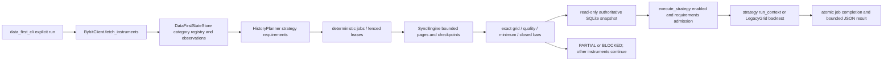

# Data-first scheduler design and source audit

Baseline 57d560a0c75b7061d1735a740da9164384420626. Existing Scheduler selects ready jobs; UniverseSynchronizer drops instrument metadata; ResearchRunner separately syncs then executes. No complete discovery-to-results runtime exists at this baseline. Generic executor ignores disabled state and requirements have no minimum observation contract. Sync range edges can escape requested bounds; timestamp-count coverage alone does not prove exact sampling grid or quality.

The explicit DataFirstScheduler joins full bounded Bybit pagination, a category-qualified instrument registry, requirement planning, bounded incremental SyncEngine pages, strict coverage, the strategy executor/backtest implementation and durable results. It does not activate connected mode from the ordinary CLI. Each market category has a separate authoritative store, opened inside its executing thread through a caller factory (canonical configured store factory supported). Existing symbol-only storage is never silently shared across market types.

Instrument launch must be explicit; unknown launch stays BLOCKED. Current observations do not fabricate historical activity. Delivery/delist boundaries are exclusive; absent instruments become observation-MISSING, not historically delisted. Explicit activity intervals may constrain an owner's replay plan, but their provenance must be declared; observation intervals are not exchange history. Current discovery cannot reconstruct instruments delisted before observation. No claim of survivorship-free OOS is made.

Requirement windows use closed candle opens on their own grid, launch ceil, exclusive activity end and observation close. Each declaration adds minimum observations and optional lookback. All required requirements must independently be READY; unsupported historical funding/trades/microstructure require an explicit verified archive contract, never minute-density assumptions or recent trades substitutes. Generic direct execution also enforces disabled permission, minimum observations and supported coverage.

Deterministic job keys bind instrument identity, actual strategy fingerprint and planned windows. Durable SQLite jobs/events/results use WAL/FULL and fenced leases. Data writes commit per page; restart recomputes gaps from authoritative storage if state checkpoint publication was interrupted. Completion/result publication is atomic and fenced; unknown in-flight strategy outcomes become BLOCKED, not automatically rerun as exactly-once. Cancellation is cooperative between bounded calls/pages and exposed through strategy context; arbitrary Python strategy code is not forcibly interruptible.

Per-cycle active jobs, page calls, observed rows, universe size, result size and wall/CPU admission are bounded. Ready work is prioritized before further sync, and incomplete instruments never gate unrelated ready instruments. Rate limiting is shared across requests, including retries. No production DB/service writes or Bybit requests on LS5 are authorized. Synthetic session fixtures and disposable SQLite prove software only.

## Implementation plan

1. RED→GREEN direct disabled/minimum/off-grid tests; add research-only bound permit and declaration fields.
2. Harden discovery pagination and incremental sync budgets/cancellation/range clipping, preserving legacy API defaults.
3. Add history planner, strict data validation and category-isolated registry/state/result store.
4. Add bounded fair coordinator and explicit CLI; synthetic multi-instrument restart/cancellation E2E.
5. Independent review, targeted regression, hosted exact-head CI/artifact evidence, separate Draft PR. No main merge.

Read-only external connection plan: public instruments/kline GET endpoints only, no API credentials/order endpoints; explicit owner-approved network scope and dedicated disposable output root are prerequisites. Review Bybit region access, category/timeframe support, Retry-After and pagination ceilings before connection. Sources: https://bybit-exchange.github.io/docs/v5/market/instrument , https://bybit-exchange.github.io/docs/v5/market/kline , https://bybit-exchange.github.io/docs/v5/market/history-fund-rate .

LS5_CONNECTED_SYNC=NOT_AUTHORIZED; PHYSICAL_G1=NOT_AUTHORIZED; TRADING=NO-GO.

## Actual runtime and ownership



| Responsibility | Implementation |
|---|---|
| Full cursor pagination/category/stream byte budget | marketdata/bybit_client.py |
| Launch/delivery, closed per-TF windows, minimum/trailing lookback | marketdata/history_planner.py |
| Qualified instrument metadata/current observations/archive claims | persistence/data_first_store.py |
| Atomic jobs, event history, leases, checkpoint/result publication | persistence/data_first_store.py |
| Bounded fair concurrency, shared rate limit, cancellation/resource admission | engine/data_first.py |
| Incremental gap repair and committed page checkpoint | marketdata/sync_engine.py |
| Persistent market binding/finite quality/coherent read transaction | marketdata/sqlite_store.py |
| Canonical shard routing and single authoritative snapshot | marketdata/sharded_store.py and store_factory.py |
| Disabled permit, exact requirements/minimum gates | engine/executor.py |
| Existing direct runner permission before any sync | research/runner.py |
| Backtest | strategies/builtin/legacy_grid.py, existing implementation unchanged |
| Explicit runtime entry point / read-only connection plan | data_first_cli.py |

The old generic Scheduler/WorkerRuntime remain compatible job infrastructure, not a hidden second discovery loop. The new dedicated entry point is the complete data-first runtime. Existing ResultStore remains compatible; data-first completion and result live atomically in the same coordinator transaction rather than introducing a cross-DB publication race. Category binding is persisted inside market/shard storage, not merely cached in the scheduler.

## Reviewed defects and compatibility changes

Confirmed before fixes: disabled direct execution; minimum observations absent; off-grid dense timestamps accepted; missing range edges could escape the request. Independent review additionally reproduced cross-instance linear/spot aliasing (P1), stale archived interval/provenance execution (P1), interrupted RUNNING automatic replay without checkpoint (P1), stale enabled-definition at admission (P2), and conflicting duplicate candle timestamps last-wins (P2). Regression tests now reject these cases. A stored READY is revalidated against a read-only snapshot before execution.

The requirement fingerprint now includes minimum observations and trailing lookback. Old experiment identities must not be reused as new PASS. `lookback_ms` denotes a trailing requirement window inside the requested historical interval, not invented prelaunch warmup. Bybit custom sessions now accept `stream=True`. Malformed auxiliary timestamps are REPAIR_REQUIRED rather than RETRYABLE; the old test name/expected status and mandatory manifest are updated explicitly, with the earlier failure retained in evidence. Required funding, raw trades, aggregated trades and microstructure stay BLOCKED in this scheduler without an independently reviewed historical provider contract. A current fundingInterval is never used to fabricate historical settlements.

An existing nonempty unqualified market database cannot be bound automatically. An owner must explicitly establish its category provenance before using it. No acknowledgement/migration of existing LS5 stores was performed. Caller-supplied archived activity intervals have source hashes but are explicitly not producer attestation. Current discovery, especially spot metadata without launchTime, cannot prove missing historical activity; unknown facts remain BLOCKED.

## Limits and remaining external conditions

Defaults: 2 concurrent jobs, shared 2 requests/sec, 1 sync page/job/tick, 16 jobs/tick, 100000 observations/requirement (absolute configurable ceiling 1000000), 30 second cooperative tick deadline, 60 second lease, 1 MiB result, 8 MiB streamed HTTP body. Session requests in the CLI use 10 second I/O timeout and one attempt; later repair is an explicit bounded next tick. Every retry is rate-gated and backoff is cancellation-aware. The CLI uses the existing RAM/disk/CPU resource admission and configured shard factory. An arbitrary noncooperative strategy or stuck native call cannot be forcibly bounded by this thread coordinator; this is not an OS sandbox or physical readiness proof.

Expired/cancelled RUNNING work with no independently valid checkpoint remains BLOCKED, requiring operator reconciliation. No claim of exactly-once arbitrary external side effects is made. The strategy context exposes a query-only SQLite snapshot, never an exchange client or credentials. Unknown archive revisions, first availability and historic universe membership still block real OOS; software fixture results are not market profitability.

## Reproduction and read-only real connection plan

```powershell
python -m pytest tests/engine tests/marketdata tests/strategies tests/persistence tests/research/test_runner.py -q
python -m strattester.data_first_cli plan-connection
```

The plan command creates no directory/client or network request. A future owner-authorized connection uses the separate `run --root <NEW_DEDICATED_ROOT> --start-ms <inclusive-open> --end-ms <exclusive-close> --category linear --ticks 1 --allow-network` command. That flag is an explicit activation guard, not owner authorization. Existing unrelated roots (including the physical smoke directory) are rejected. GET only, no API keys, no environment proxy/netrc, no PostgreSQL/Grid configuration, no service/firewall/PATH change, no orders. Review the new workspace, URLs/categories, response/page/rate budgets, historic source blockers and retained evidence before approval. No real connection command was executed on LS5.

Hosted `data-first-scheduler` CI uses synthetic clients and disposable SQLite on Windows/Linux Python3.11/3.12/3.13, raw JSON/JUnit/node IDs and exact HEAD/tree/dependency/artifact hashes. Local source regression scope deliberately excludes neural model/B1/B2 execution. The separate B1/B2 diagnostic branch remains undeployed and execution unauthorized.

### Direct-executor TOCTOU followup

Candidate56ae944 passed scheduler/CI checks but a separate direct-executor regression reproduced a writer deleting data between readiness validation and strategy consumption (output0). Generic execution now opens the same read-only coherent snapshot around both steps; nested scheduler snapshots are reused. The race regression expects the original validated row (output1) and passes. Sharded generic admission expands declaration timeframes and refuses cross-authority snapshots. Independent focused followup:10passed; complete local scoped regression:211passed. Prior56CI artifacts are retained as historical and do not establish PASS for the followup HEAD.

