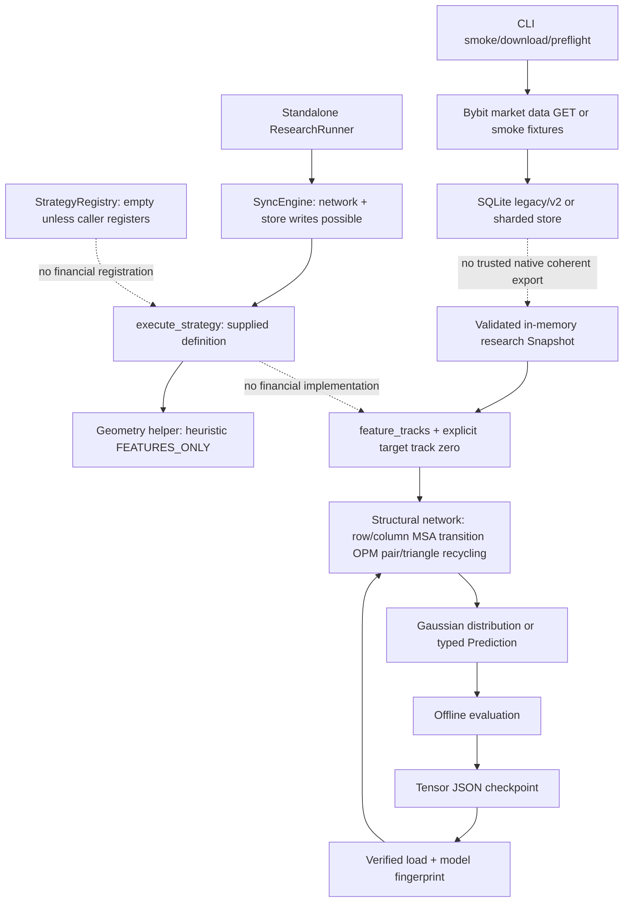

# Strattester system readiness — prephysical candidate

Scope: owner request2026-10-24, independent QA comment6386645500, source baseline67301726d250973602b964adabdb9eb8d50d0f13. Read this with PHYSICAL_G0.md, GRID_EXPORT_SPEC.md and the three independent audit reports. Exact successor commit/CI receipts are recorded in the delivered evidence packet; this file cannot contain its own commit hash.

| Required result | Verdict | Reason |
|---|---|---|
| STRATTESTER_SYSTEM_READINESS | BLOCKED | missing CLI→financial registry/runtime path; runner online-capable; full confinement/recovery not established |
| ALPHAFOLD_MODEL_READINESS | CPU_ENGINEERING_PASS / PHYSICAL_BLOCKED | actual operators run; no full upstream equivalence, real GPU, market OOS or accepted calibration/cost protocol |
| GRID_SNAPSHOT_READINESS | BLOCKED | no native attested producer cut, historical availability/revision and deployed schema evidence |
| PHYSICAL_G0_READINESS | PARTIAL / UNSIGNED | local LS5 read-only inventory captured; PC4 identities, dedicated ACL sandbox, ownership map and owner signature missing |
| PHYSICAL_G1_AUTHORIZATION_RECOMMENDATION | DENY / NO-GO | independent physical QA and owner-scoped G1 authorization absent; this work grants none |

## Provenance and changed source branches

PR21 remained Draft on integration/alphafold-financial-system, main37ff7e9d12a4d2dccd788fc493c28557dbe8bcea unchanged. PR15–21 re-read via GitHub and refs fetched before changes. Original imported blob provenance remains docs/integration/component-origins.json. No source branch overwritten or bulk merge performed.

| PR | Current reviewed HEAD | Delta since integration import |
|---|---|---|
|15|02bb79796b9627345b8f7c98a50349d044e5b7be|unchanged|
|16|5aadb120ac37f4832ea74c055051878c6a3171c6|unchanged|
|17|eab45b5d9ce04f8282755684a1c1e93b03e38c77|207lines: receipt callback verifier/tests + physical readiness doc|
|18|afeab9e8e71d5ebc0114cd0ed693db613a86fbcd|145lines: independent Decimal/time oracles/tests + workflow|
|19|24045ec1035c34f13e3b70c1c13dff2cb789ef34|121lines: signed-funding/calibration reference functions/tests + readiness doc|
|20|2c5e378777112b9152e42cf2261f29ef8d29bf13|53lines: independent physical assessment + acceptance bypass characterization|
|21 baseline|67301726d250973602b964adabdb9eb8d50d0f13|this readiness work starts here|

Updated source additions were reviewed as independent evidence, not silently imported. PR20 observed insecure API behavior has new rejection regression tests here. PR17 receipt callback is not an actual producer; PR18 references do not establish runtime wiring; PR19 signed funding oracle is not wired into current experiment ledger. Grid source d537d525296ef34f727996e240ae6c60102c6082; math ccfe97dd88b1ebee9bd19795002a30d0bd1c1ca3 has no executable implementation; AlphaFold reference c77e5d2a8961d1a353632c462914ff0a32a950f6. No deployed schema/version identity inferred from these source SHAs.

## Actual runtime graph and incompatible interfaces



No CLI instantiates ResearchRunner or financial experiment; service worker is liveness/heartbeat. Registry's empty constructor is not a populated application registry. Geometry definition.enabled=False exists but no registration; executor dispatch does not enforce enabled metadata. Financial standalone backend is not registered as a real strategy. `run_experiment`/`run_walk_forward` and `load_checkpoint`→`predict_snapshot` are separate tested library paths. Unsupported live schema is rejected, not repaired by inferred fields. These are readiness gaps, not assertions that every isolated module is unreachable from Python.

Source scan found no exchange order placement endpoint/client implementation in concrete research dependency path; Bybit client exposes market GETs, model has no exchange client. E2E test denies socket connect and create_connection. This proves the bounded tested path only. Arbitrary injected Python executors/clients and Telegram/online sync mean whole-application/machine egress and all possible order side effects are NOT_PROVEN. No trading credentials, orders or physical runtime launched.

## Findings and disposition

| Priority / ID | Evidence and disposition |
|---|---|
|P0 physical blocker GRID-TRUST|Native cross-store attested immutable historical export absent. Source DDL lacks required truth. Not a reproduced live exploit; final acceptance cannot proceed. SPEC+14 independent conformance cases supplied, native exporter/deployed facts BLOCKED.|
|P1 ACCEPT-01 FIXED|Six RED cases: empty/forged external map gave PASS, arbitrary self-reported node accepted, reduced gate set and bool schema accepted. Aggregator now loads pinned repository requirements, requires every gate, disallows external upgrades, labels self-report authenticity UNVERIFIED, always G1 NOT_AUTHORIZED.23 tests GREEN. This fixes API acceptance, not independent CI attestation.|
|P1 FS-01 FIXED within trusted-directory scope|Attacker modifying staging bytes immediately before link caused returned SHA≠published bytes. New regression rejects without returning a digest, preserves unregistered failed final for operator recovery, validates published bytes after unlinking temp. Loader already rejected original mismatch; no hash bypass claimed.|
|P1 SYSTEM-01 OPEN|Financial backend not wired to CLI/runner/real registry; exact source evidence in independent system audit. A safe complete bridge needs producer export and offline capability boundary; no unsafe mutable-store shortcut added.|
|P1 OFFLINE-01 OPEN|ResearchRunner always syncs online-capable client; no application-level strict offline capability. Targeted e2e connect denial passes, full runner/network sandbox not proven.|
|P1 ML-01 OPEN|No real-market OOS or historical signed funding schedule; experiment does not forward funding. Current roundtrip turnover is2*abs(position) per horizon, costs per side, flat horizon funding magnitude; no actual margin liquidation/portfolio execution. Closing at label end is not liquidation simulation.|
|P1 MODEL-01 OPEN|CPU-only implementation; incomplete independent row/triangle-attention/recycling numerical equivalence; calibration acceptance and control portfolio comparison not established. No full original AlphaFold claim.|
|P1 RESOURCE-01 OPEN|Forward admission does not bound accumulated example tensors/asdict/cat, concurrent jobs, allocator peak or OS memory. Actual OOM not induced; source-level coverage/admission gap. Windows job-object/cgroup confinement missing.|
|P1 RECOVERY-01 OPEN|Abrupt os._exit before/after publication leaves unregistered temp, and after-link case leaves final+temp. Handled cancellation cleans; crash recovery/dir durability not fully proven. No automatic cleanup of unidentified artifacts.|
|P1 FS-WINDOWS OPEN|Ancestor junction/reparse swap and hostile writable directory confinement not solved by portable path checks. Handle-based Windows trusted-root enforcement requires separate implementation/test before physical authorization.|
|P1 EVIDENCE-01 OPEN|No independent authenticated job/attempt/artifact/JUnit/source verifier. JSON+matching IDs are self-reports. Current aggregator cannot PASS even with forged reports; raw report authenticity is not claimed.|
|P2 FS-02 FIXED|Hash-correct NTFS hardlink admitted previously. Consumer now rejects nlink≠1 and detects descriptor/path identity change. Policy hardening, no SHA bypass claim.|
|P2 JSON-01 FIXED|Deep malformed snapshot raised TypeError; bounded depth64 parser requires object root, duplicate-key/nonfinite rejection. New attack suite5cases, combined artifact/checkpoint/snapshot20tests GREEN after final review.|
|P2 DATA-02 OPEN|Normalized research_bars exists in fixture only; producer cutoff/quality/revision facts cannot be invented. Physical WAL/recovery/lock/shard routing/MVCC tests remain pending, unlike existing temporary SQLite concurrency tests.|
|P3 OBS-01 OPEN|G0 inventory is a point-in-time unsigned observation, not a reserved resource or process ownership guarantee. All counters/names may change.|

No newly reproduced P0 code exploit remains claimed. P0 denotes an acceptance-critical external blocker. Unknown or unexecuted cases stay BLOCKED, not PASS.

## Test matrix and evidence interpretation

Baseline hosted financial workflow40109884642: seven engineering jobs789passed0skipped+22subtests; system-acceptance job120921949202 intentionally FAILURE/BLOCKED. Baseline OS matrix40109884692: Windows3.11/3.13 each778pass2GPUskip; Linux3.11/3.13 each777pass3platform/GPUskip. CPU40109884775:76pass2GPUdeselected. Math40109884656:12perOS/Python job. These source-673 receipts are historical and must not certify successor code.

Current local reviewed precommit full software suite:802passed4skipped18subtests; Python3.12.10 CPU torch2.14.1. Skips2CUDA+2Windows symlink privilege retained explicitly. Independent baseline model subset45passed0skip. New spec14passed; acceptance23passed; artifact subset19passed. These overlap full suite and MUST NOT be summed as unique tests. Successor hosted CI exact SHA/run/job/attempt and raw artifact hashes are captured separately after push; until complete they are PENDING.

Pinned gate manifest after additions:core518,data61,math31,cpu94,training51,security53,integration7 =815required cases, GPU not included/never PASS. Full suite covers existing CLI/API fixtures, strategy helpers, storage legacy/v2/shard health, sync/runner, cancel/replay/checkpoint/cleanup and platform behavior only to extent named test nodes execute. It is not proof of every untested branch or physical deployment. Ordinary service/download/bootstrap CLIs were not executed on host because they may mutate active state or access network. Actual concurrent PostgreSQL+shard/source replacement/WAL crash stress, Linux physical node, GPU OOM, OOS and exhaustive malformed ZIP/job-identity authentication are NOT_RUN/BLOCKED.

## Reproduction (existing environment only)

From integration checkout, PowerShell:

```powershell
$env:OMP_NUM_THREADS='1'
$env:MKL_NUM_THREADS='1'
../financial-venv/Scripts/python.exe -m pytest -q --basetemp=../tmp-g0-repro --json-report --json-report-file=../g0-repro.json --junitxml=../g0-repro.xml
../financial-venv/Scripts/python.exe -m pytest -q tests/research/test_physical_acceptance_attacks.py tests/research/test_physical_artifact_attacks.py tests/research/test_grid_export_spec_reference.py --basetemp=../tmp-g0-attacks
./scripts/physical_g0_inventory.ps1
```

Hosted exact-node reproduction from CLEAN pinned checkout uses installed CI dependencies and `python scripts/financial_gate.py --gate GATE --sha EXACT_SHA --output results/financial-ci` for each pinned gate. Aggregate intentionally exits2/BLOCKED with external gates unresolved. RED evidence is preserved in packet; do not rerun insecure baseline in a working checkout or pass it off as current success.

## Remaining assumptions and external owner work

Need actual producer/schema/history authority and signed immutable Grid export; exact PC4/other-node identities; read-only physical roles and service ownership; independent signing/trust policy; Windows/Linux confinement; hardware-qualified GPU execution; market-derived leakage-safe training/OOS with funding/fills/calibration; independent final QA on common commit. No owner signature is fabricated. Main/working DBs/services untouched. G1 remains separately authorized by owner only after independent QA; no automatic transition is implemented.

## Source-head CI refresh and final independent review

Current PR15 tests40097864981 SUCCESS; PR16 CPU40101274631 and tests40101274637 SUCCESS; PR17 tests40112076428 SUCCESS; PR19 tests40112005378 SUCCESS. PR18 math40112097565 FAILURE (all4jobs; e.g.120925772519), imports financial_evaluation absent from its standalone branch; its ordinary tests40112097394 SUCCESS. PR20 tests40112015533 FAILURE at collection (job120925525729; other jobs cancelled), imports financial_acceptance absent from its standalone branch. Failed logs preserved; no source branch changed. These are dependency/collection failures and not numerical PASS or integration-candidate regressions. Metadata is not authenticated artifact evidence.

Fresh independent final review found one introduced cleanup race, reproduced RED1fail5pass, then corrected by preserving failed final artifact and never unlinking target by pathname. Independent recheck20passed. Complete reviewed suite802pass4skip18subtests; new regression included in security manifest53. No remaining introduced P0/P1 identified by that bounded review; external/system/model limitations remain OPEN. See INDEPENDENT_FINAL_REVIEW.md.
